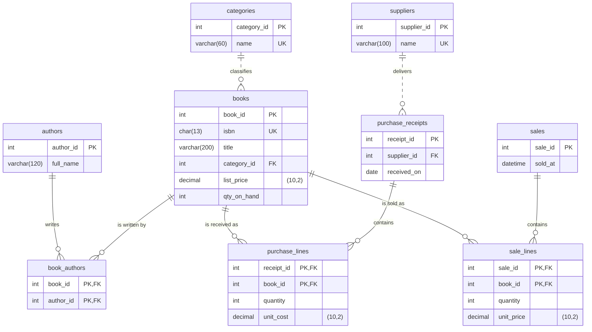

# Database design

This page describes the database behind the Bookshop Inventory & Sales Management System: its tables and relationships, how it is normalized, the SQL it uses, and how receipts and sales keep the stock correct. The [README](../README.md) explains setup, and [ASSIGNMENT.md](../ASSIGNMENT.md) is the project brief.

The SQL is in `db/`: `schema.sql` creates the tables, indexes and views, `seed.sql` loads fictional sample data, and `queries.sql` holds example queries.

## Database model



The diagram shows the nine tables with their columns, SQL types (`(10,2)` is the precision of each `DECIMAL`), and primary (PK), foreign (FK) and unique (UK) keys. Solid lines are identifying relationships, where the foreign key is part of the child's primary key; dashed lines are not. The foreign keys allow a parent with no children. Saving a book with at least one author, and a receipt or sale with at least one line, is ensured by the application when it creates them.

## Relationships, keys and normalization

**Relationships**

- A category has many books, and each book belongs to one category.
- Books and authors are many-to-many. The junction table `book_authors` holds one row for each book–author pair, and its primary key is the pair (`book_id`, `author_id`).
- A supplier has many purchase receipts. Each receipt has lines in `purchase_lines`, and each sale has lines in `sale_lines`. A line links its document to one book and records the quantity and price, so receipts and sales are many-to-many with books.

**Keys and constraints.** Every table has a numeric primary key or, for the line and junction tables, a composite one. ISBNs, category names and supplier names are unique. Foreign keys make every line point to an existing book and document, and stop a referenced row from being deleted. CHECK constraints keep prices, costs and quantities above zero and stock at zero or more. Money is stored as `DECIMAL(10,2)`, so amounts are exact.

**Normalization.** Without a database, the shop might keep one sheet with a row for each book sold: sale date, ISBN, title, author names, category, price and quantity. The tables come from removing the repetition in that sheet:

- **1NF:** the author names are a list in one cell. They become rows in `authors`, linked to books through `book_authors`.
- **2NF:** with the key (sale, ISBN), the sale date depends only on the sale, and the title only on the ISBN. Splitting these out gives `sales`, `books` and the `sale_lines` that join them; `sale_id → sold_at` and `isbn → title` now each live in their own table.
- **3NF:** the category name depends on the category, not directly on the book (`book_id → category_id → name`), so it moves to `categories`.

Receipts are split the same way into `suppliers`, `purchase_receipts` and `purchase_lines`. As a result, each title, author, category and supplier name is stored once. Changing one changes it everywhere, and deleting a sale cannot remove information about a book.

**Historical prices.** `books.list_price` is the current selling price. Each sale line stores the `unit_price` actually charged, and each receipt line stores the `unit_cost` paid. The line's price therefore does not depend on the book alone, and editing a book's price never changes a past invoice or receipt.

**Stored stock.** `books.qty_on_hand` is kept on purpose, because checkout needs one row to lock and check. It always equals the units received minus the units sold. Only receipts and sales change it, and the reconciliation query in `queries.sql` checks that it still matches the line tables.

## SQL queries, views and indexing

**Joins.** The catalogue joins four tables and combines each book's authors into one column:

```sql
SELECT b.title, c.name AS category, b.list_price, b.qty_on_hand,
       GROUP_CONCAT(a.full_name ORDER BY a.full_name SEPARATOR ', ') AS authors
FROM books b
JOIN categories c ON c.category_id = b.category_id
JOIN book_authors ba ON ba.book_id = b.book_id
JOIN authors a ON a.author_id = ba.author_id
GROUP BY b.book_id, b.title, c.name, b.list_price, b.qty_on_hand;
```

**Aggregation.** The Records screen lists the top-selling books:

```sql
SELECT b.title, SUM(sl.quantity) AS units, SUM(sl.quantity * sl.unit_price) AS revenue
FROM sale_lines sl
JOIN books b ON b.book_id = sl.book_id
GROUP BY b.book_id, b.title
ORDER BY units DESC, revenue DESC, b.title
LIMIT 5;
```

**Views.** `v_sale_totals` gives each sale's date, number of lines, units and total. `v_receipt_totals` gives the same for each receipt, with the supplier's name. The Records screen reads its recent invoices, receipts and totals from these views, so the totals are calculated in one place and never stored. `queries.sql` also has examples with `HAVING`, `NOT EXISTS` and the stock reconciliation.

**Indexes.** Besides the primary keys and the unique keys on ISBN, category name and supplier name, there are six secondary indexes:

- Five support foreign keys: `books(category_id)`, `book_authors(author_id)`, `purchase_receipts(supplier_id)`, `purchase_lines(book_id)` and `sale_lines(book_id)`. The two line-table indexes are also used for top sellers and reconciliation.
- `idx_sales_sold_at` supports chronological queries, such as the recent-invoice list and revenue by date.

For example, `EXPLAIN` on the query for one month's revenue in `queries.sql` shows a range scan on `idx_sales_sold_at`: MySQL reads only that month's sales instead of every sale.

## Receiving and checkout

Each receipt and sale is saved in a single transaction on one connection:

- **Receipt:** insert the receipt and its lines, then increase each book's stock.
- **Sale:**
  1. Lock the books with `SELECT … FOR UPDATE`.
  2. Check that each has enough stock.
  3. Insert the sale and its lines at the prices read from the locked rows.
  4. Decrease each book's stock.

If any step fails, for example because a book does not have enough stock, the whole transaction is rolled back and nothing is saved. The total shown at checkout is only an estimate; the saved invoice uses the prices stored in the database.

## Concurrent sales

When two checkouts compete for the last copy of a book, the first transaction locks the book's row. The second waits for that lock. After the first sale commits, the second transaction reads the updated stock and refuses the sale, because no copy remains.

Two more details complete this:

- **Lock order:** books are always locked in order of `book_id`, so two sales of the same books cannot deadlock by locking them in opposite orders.
- **Final guard:** the `CHECK (qty_on_hand >= 0)` constraint stops stock from ever going below zero.
